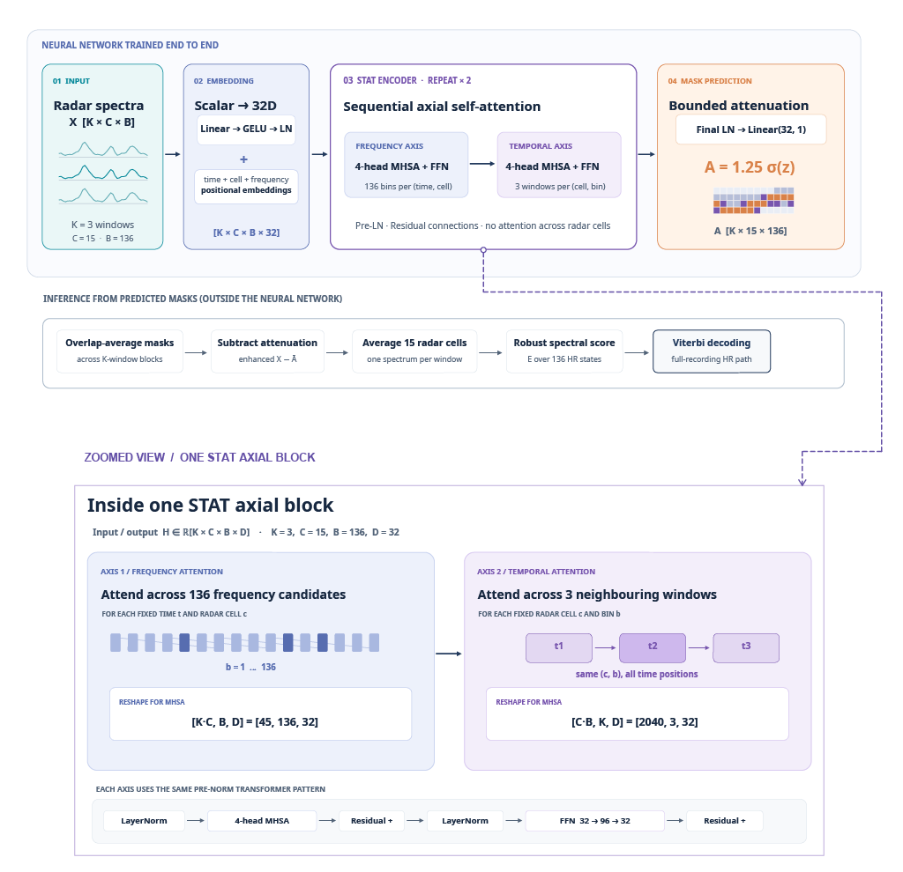

# ICR-DS Research

Research code for radar-based heart-rate estimation using the **In-Cabin Radar Dataset (ICR-DS)**. This repository contains the proposed **STAT** method, implementations of comparison methods, radar-processing scripts, and a script for organising the subject-level training and testing files.

> **Dataset:** The ICR-DS data are hosted separately on Hugging Face: **[Anima-Rahman/icr-ds](https://huggingface.co/datasets/Anima-Rahman/icr-ds)**.
>
> **Research paper:** The accompanying paper is not yet published. The repository can still be cited using the metadata in [`CITATION.cff`](CITATION.cff).

## Project overview

ICR-DS is a multimodal in-cabin driving dataset collected from 28 participants during approximately 50 minutes of real-world urban and highway driving. It includes radar recordings, BioHarness physiological measurements, derived vision measurements, vehicle data, and pre-/post-drive Psychomotor Vigilance Test (PVT) outcomes.

This repository focuses on **non-contact heart-rate estimation from in-cabin radar**. It provides code for the proposed STAT method and five comparison methods:

- **STAT** - the proposed spectro-temporal method. It uses fixed chest-region radar channels, spectral features, frequency- and temporal-axis Transformer processing, and a learned spectral attenuation mask. BioHarness-derived heart rate is used as the training reference, not as a model input.
- **VitaNet** - an ICR-DS adaptation inspired by the published VitaNet approach, using radar phase-derived respiratory and cardiac bands to estimate scalar heart rate.
- **mmFormer** - an ICR-DS adaptation using complex radar I/Q windows from four receivers and four selected range bins to estimate scalar heart rate.
- **HeartTimeMixer** - an ICR-DS adaptation that uses the full 13-range-bin I/Q archive produced by the mmFormer radar generator. It does **not** require a separate HeartTimeMixer data export.
- **HRConvNet** - an ICR-DS adaptation using EWT-inspired time/frequency radar features.
- **Alizadeh FFT** - a classical FFT-based heart-rate estimation baseline. The included script evaluates the precomputed Alizadeh estimates; it is not a neural-network training script.

The implementations are research adaptations for ICR-DS, not necessarily exact reproductions of the original studies or official code released by their authors. The assumptions and differences are documented in the relevant source-file docstrings.

## STAT architecture

The diagram below illustrates the proposed STAT architecture.

<!-- Add the final diagram at docs/figures/stat_architecture.png. -->



## Repository structure

```text
ICR-DS-Research/
├── README.md
├── docs/
│   └── figures/
│       └── stat_architecture.png
├── LICENSE
├── CITATION.cff
├── requirements.txt
├── .gitignore
│
├── STAT/
│   └── train_STAT.py
│
├── baselines/
│   ├── VitaNet/
│   │   └── train_vitanet.py
│   ├── mmFormer/
│   │   └── train_mmformer.py
│   ├── HeartTimeMixer/
│   │   └── train_hearttimemixer.py
│   ├── HRConvNet/
│   │   └── train_hrconvnet.py
│   └── Alizadeh_FFT/
│       └── evaluate_alizadeh.py
│
└── scripts/
    ├── organise_icrds_splits.py
    └── radar_generator/
        ├── STAT/
        │   ├── dataset.py
        │   ├── timeseries_generator.py
        │   └── preprocess_dataset.py
        └── baselines/
            ├── alizadeh_generator.py
            ├── hrconvnet_generator.py
            ├── mmformer_generator.py
            └── vitanet_generator.py
```

## Dataset access

Download the prepared dataset from the ICR-DS Hugging Face dataset page:

**Hugging Face:** [Anima-Rahman/icr-ds](https://huggingface.co/datasets/Anima-Rahman/icr-ds)

The prepared release is organised into `Train/` and `Test/` partitions. STAT uses PyTorch `.pt` files. The baseline methods use method-specific HDF5 (`.h5`) files. HeartTimeMixer uses the full I/Q archive stored in the mmFormer-style HDF5 export, so no separate HeartTimeMixer directory is required.

The public dataset documentation describes the HDF5 groups, tensor dimensions, timing information, labels, and method-specific representations. Please consult the Hugging Face dataset README for the full data schema and loading details.

### Data availability

- **Raw in-cabin RGB video:** Not included in the public release due to ethical and participant-privacy requirements. Derived vision measurements are provided instead.
- **Raw radar ADC recordings:** Not included in the public release. Researchers interested in these recordings may contact the dataset authors at **anima.rahman.1@warwick.ac.uk** to enquire about research access.
- **Prepared radar and reference data:** Available through the Hugging Face dataset release, subject to the dataset's stated licence and conditions.

The dataset's licence is separate from the software licence for this repository. Please consult the Hugging Face dataset card for the dataset licence and access conditions.

## Participant-level data split

Experiments use a fixed participant-level split to prevent the same participant from appearing in both training and testing:

- **Training (21):** `s001–s002`, `s004`, `s006–s007`, `s012–s017`, `s019–s028`
- **Testing (5):** `s003`, `s005`, `s008`, `s010`, `s018`
- **Excluded (2):** `s009`, `s011` (no BioHarness reference recordings)

The allocation is defined in `scripts/organise_icrds_splits.py`. The STAT training script also checks that its training input contains the expected 21 participants.

## Environment

The project environment is based on:

- **Python:** 3.10
- **GPU used for development:** NVIDIA GeForce RTX 4080 SUPER
- **Main framework:** PyTorch

The exact PyTorch and CUDA versions have not been pinned in this repository. For GPU acceleration, install a PyTorch build compatible with your operating system, NVIDIA driver, and CUDA environment. The scripts can fall back to CPU where device selection is implemented, but training will generally be slower.

## Installation

Clone the repository and enter its directory:

```bash
git clone <YOUR-GITHUB-REPOSITORY-URL>
cd ICR-DS-Research
```

Create and activate a Python 3.10 environment. For example:

```bash
python3.10 -m venv .venv
```

On Windows (PowerShell):

```powershell
.venv\Scripts\Activate.ps1
```

On macOS or Linux:

```bash
source .venv/bin/activate
```

Install the listed dependencies:

```bash
python -m pip install --upgrade pip
python -m pip install -r requirements.txt
```

If PyTorch does not detect the NVIDIA GPU, install the PyTorch build appropriate for your CUDA setup using the official PyTorch installation instructions, then verify the installation:

```bash
python -c "import torch; print('PyTorch:', torch.__version__); print('CUDA available:', torch.cuda.is_available()); print('GPU:', torch.cuda.get_device_name(0) if torch.cuda.is_available() else 'CPU')"
```

## Data preparation

### Using the prepared Hugging Face files

If you download the already-prepared `Train/` and `Test/` partitions from Hugging Face, you can use those files directly. Place the downloaded data in a local ICR-DS directory and set the `DATA_ROOT` (and, where relevant, `SESSION_ROOT`) path in the script you intend to run.

The training scripts expect the method folders to use the following names:

```text
ICR-DS/
├── Train/
│   ├── STAT/
│   ├── VitaNet/
│   ├── mmFormer/
│   └── HRConvNet/
└── Test/
    ├── Alizadeh/
    ├── VitaNet/
    ├── mmFormer/
    └── HRConvNet/
```

The STAT training script reads `Train/STAT/sXXX_session.pt`. The neural baseline scripts read their respective method-specific HDF5 files from the corresponding `Train/` directory. The Alizadeh evaluation script reads `Test/Alizadeh/`.

Some method-specific HDF5 files use HDF5 external links to access the associated session-level physiology group. If those links do not resolve in your local copy, set `SESSION_ROOT` in the relevant training or evaluation script to the directory containing the corresponding `sXXX_session.h5` files.

### Regenerating method-specific data from raw radar ADC

The radar generators are included for researchers who have authorised access to the raw radar ADC recordings and the aligned session-level HDF5 files. Raw ADC recordings are not part of the public download.

The generators use a local ICR-DS directory with participant folders such as `sub-001/`, containing `raw/radar/` ADC files and `processed/` session HDF5 files. Before running a generator, edit its `DATA_ROOT` constant to point to the directory containing the `sub-XXX` folders.

The available generation scripts are:

```bash
# STAT radar time-series preparation
python scripts/radar_generator/STAT/timeseries_generator.py
python scripts/radar_generator/STAT/preprocess_dataset.py

# Method-specific baseline exports
python scripts/radar_generator/baselines/alizadeh_generator.py
python scripts/radar_generator/baselines/hrconvnet_generator.py
python scripts/radar_generator/baselines/vitanet_generator.py
python scripts/radar_generator/baselines/mmformer_generator.py
```

The STAT preprocessing script creates model-ready `.pt` files from the session HDF5 radar branches. The baseline generators create their corresponding method-specific HDF5 files. The mmFormer generator also stores the full 13-range-bin I/Q archive used by HeartTimeMixer.

The raw-ADC generators make assumptions about the radar acquisition layout and timing. These assumptions are described in their docstrings and should be checked against the acquisition configuration before processing new recordings. The generated baseline representations are ICR-DS adaptations of the referenced methods.

### Organising the subject-level Train/Test directories

If your files are arranged under `sub-XXX/processed/`, edit `DATA_ROOT` in `scripts/organise_icrds_splits.py` and run:

```bash
python scripts/organise_icrds_splits.py
```

The script copies the prepared STAT `.pt` files and baseline HDF5 files into subject-level `Train/` and `Test/` directories. It does not move or delete the source files and does not overwrite existing destination files. If you have already downloaded the prepared `Train/` and `Test/` structure from Hugging Face, you do not need to run this organiser.

**Important before running:** the current `HDF5_METHODS` mapping in `organise_icrds_splits.py` uses lowercase destination folder names, whereas the training scripts expect `VitaNet`, `mmFormer`, and `HRConvNet` with the capitalisation shown above. Update the mapping keys to the expected folder names before running the organiser:

```python
HDF5_METHODS = {
    "HRConvNet": "hrconvnet",
    "Alizadeh": "alizadeh",
    "VitaNet": "vitanet",
    "mmFormer": "mmformer",
}
```

## Running the methods

Before running a script, edit its `DATA_ROOT` constant to the location of your local ICR-DS directory. For scripts that use HDF5 external physiology links, set `SESSION_ROOT` if the links do not resolve automatically.

Run commands from the repository root:

### STAT

```bash
python STAT/train_STAT.py
```

STAT uses 36-second analysis windows with an 18-second hop. Its `.pt` input contains full radar spectra and aligned BioHarness reference heart-rate labels. The training code maps the full spectra onto 136 heart-rate bins spanning 45–180 bpm. It trains for 100 fixed epochs and saves checkpoints and training metrics under `ICR-DS/results/STAT/`.

The current STAT script uses the training partition only. It does not use a validation set, perform early stopping, or select a best epoch; the final 100th-epoch checkpoint is saved.

### VitaNet

```bash
python baselines/VitaNet/train_vitanet.py
```

### mmFormer

```bash
python baselines/mmFormer/train_mmformer.py
```

### HeartTimeMixer

```bash
python baselines/HeartTimeMixer/train_hearttimemixer.py
```

HeartTimeMixer reads the full `radar/rx_iq_36s` archive from the mmFormer-style HDF5 exports. It does not read only the four-bin `mmformer/input` tensor.

### HRConvNet

```bash
python baselines/HRConvNet/train_hrconvnet.py
```

The four neural baseline training scripts use the training partition and run a fixed 100-epoch schedule. Their current implementations do not perform validation-based checkpoint selection or early stopping. The default output directories are under `results/` in the working directory.

### Alizadeh FFT evaluation

```bash
python baselines/Alizadeh_FFT/evaluate_alizadeh.py
```

This script evaluates the precomputed Alizadeh estimates on the `Test/Alizadeh/` partition and writes prediction and pooled-metric files under `results/alizadeh/`. It is an evaluation script, not a training script.

**Evaluation note:** the current repository includes the Alizadeh evaluation script. Separate held-out test-evaluation scripts for the trained neural methods are not included in this code release. Training-set metrics should not be interpreted as independent test-set performance.

## Experimental windows and representations

The main radar analysis window used by the supplied ICR-DS processing and model scripts is 36 seconds (400 frames at a 0.09-second frame period), with an 18-second hop (50% overlap).

| Method | Prepared representation | Window configuration |
|---|---|---|
| STAT | 15 complex radar channels converted to full-window phase spectra; `.pt` files contain `x` and aligned `y` | 36 s, 18 s hop |
| VitaNet | Phase-derived breathing and cardiac bands across 12 antenna channels and 13 range bins | 36 s, 18 s hop |
| mmFormer | Complex I/Q from four receivers and four selected range bins | 36 s, 18 s hop |
| HeartTimeMixer | Full complex I/Q archive across four receivers and 13 range bins from the mmFormer-style export | 36 s, 18 s hop |
| HRConvNet | EWT-inspired time/frequency representation with shape `[2, 8, 400]` | 36 s, 18 s hop |
| Alizadeh FFT | Range-selected slow-time I/Q, phase and FFT-derived heart-rate estimates | 36 s, 18 s hop |

The STAT `.pt` input described in the training script has `x` with shape `[N, 15, 1438]` and `y` with shape `[N]`. STAT interpolates the spectral representation to its 136-bin heart-rate grid during training.

## Outputs

Training and evaluation scripts create model checkpoints, metrics, or prediction files in their configured output directories. These generated artefacts are not required to download the source code and should not be committed to the Git repository unless there is a specific reason to share them. The `.gitignore` file excludes common dataset files, checkpoints, temporary files and experiment outputs.

## Citation

There is not yet a published paper describing this research project. To cite the software repository, please use the citation metadata in [`CITATION.cff`](CITATION.cff). When using an individual baseline, please also cite the original publication associated with that method. Method-specific source files identify the publications and describe the ICR-DS adaptations.

## Contact

For questions about the ICR-DS research code, dataset, or enquiries about raw radar ADC recordings, contact:

**Anima Rahman**  
University of Warwick  
**Email:** anima.rahman.1@warwick.ac.uk

## Licence

The research code is distributed under the terms stated in [`LICENSE`](LICENSE). The dataset has a separate licence; please consult the Hugging Face dataset card for its terms.
